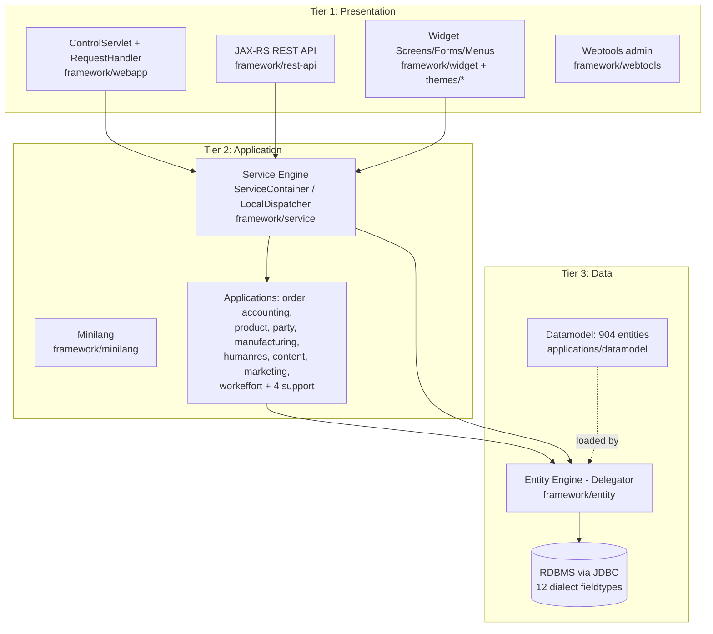

# ARCHITECTURE.md — Apache OFBiz Framework

> Repository: `ofbiz-framework` (Apache OFBiz upstream, branch `trunk`).
> This is a **descriptive** document of an existing, shipping system — not a design proposal.
> Companion implementation reference: [LOWLEVEL.md](LOWLEVEL.md). Target-state (microservices) design: [FUTURESTATE-ARCHITECTURE.md](FUTURESTATE-ARCHITECTURE.md).

## Document Index

**Quick Navigation:**
- [Section 1: Executive Summary](#1-executive-summary) → Lines 29-43
- [Section 2: System Overview](#2-system-overview) → Lines 44-62
- [Section 3: Architecture Principles](#3-architecture-principles) → Lines 63-113
- [Section 4: Architecture Layers](#4-architecture-layers) → Lines 114-154
- [Section 5: Component Details](#5-component-details) → Lines 155-191
- [Section 6: Data Flow Patterns](#6-data-flow-patterns) → Lines 192-207
- [Section 7: Integration Points](#7-integration-points) → Lines 208-221
- [Section 8: Technology Stack](#8-technology-stack) → Lines 222-239
- [Section 9: Security Architecture](#9-security-architecture) → Lines 240-252
- [Section 10: Scalability & Performance](#10-scalability--performance) → Lines 253-262
- [Section 11: Operational Considerations](#11-operational-considerations) → Lines 263-273
- [Section 12: Architecture Decision Records (ADRs)](#12-architecture-decision-records-adrs) → Lines 274-end

**Index Last Updated:** 2026-10-15

---

## 1. Executive Summary

Apache OFBiz is an open-source ERP suite and application framework written in Java 17. A single deployable monolith built with Gradle, it embeds its own web server (Apache Tomcat via `framework/catalina`) and ships both the technical framework (entity persistence, service orchestration, screen widgets, REST API) and twelve business application components (order, accounting, product, party, manufacturing, humanres, content, marketing, workeffort, securityext, commonext, datamodel).

**Key metrics (from working tree):**
- **16 framework components** + **12 application components** (`framework/`, `applications/`)
- **904 entity definitions** across 10 entitymodel XML files in `applications/datamodel/entitydef/`
- **9 service engine types** (Java, entity-auto, Groovy, script, route, interface, SOAP, Clojure, tracked)
- **12 database dialects** supported via fieldtype XML files (`framework/entity/fieldtype/`)
- **1 JVM deployable**, JDK 17 (`build.gradle` → `sourceCompatibility = JavaVersion.VERSION_17`)

**Business value:** a fully open-source, self-hostable ERP where custom business logic is added declaratively (XML services, entity definitions, screens) on top of stable, reusable engines.

---

## 2. System Overview

### 2.1 Problem Statement
Running a business requires order management, accounting, inventory, CRM, and manufacturing coordination. Commercial ERP suites are costly and closed; building each from scratch is infeasible. OFBiz provides an integrated, extensible ERP foundation under the Apache 2.0 license.

### 2.2 Solution Overview
A layered monolith where all business behavior routes through three engines:

1. **Entity Engine** — database-agnostic persistence. Entities are XML (`entitydef/`), not annotations or DDL; a `Delegator` API serves CRUD/find.
2. **Service Engine** — all business logic is a named "service" declared in XML (`servicedef/`), invoked through `LocalDispatcher`, implementable in Java, Minilang (XML), Groovy, or auto-generated from entities.
3. **Web/Widget layer** — screens, forms, and menus are XML definitions rendered to HTML via FreeMarker themes; a single `ControlServlet` per webapp dispatches requests through `controller.xml`. A parallel JAX-RS REST API (`framework/rest-api`) maps HTTP verbs to services.

### 2.3 Primary Use Cases
- **Back-office ERP** — order entry, invoicing, GL accounting, catalog, warehouse, manufacturing (applications layer via back-office screens).
- **Headless ERP** — REST API consumption by external frontends (`framework/rest-api`, OpenAPI/Swagger documented).
- **Business framework** — downstream projects build custom components on the engines (component-loading mechanism, `ofbiz-component.xml`).

---

## 3. Architecture Principles

*(Principles below describe how the existing system actually behaves, with honest trade-offs.)*

### 3.1 Separation of Concerns
**Description:** Technical engines are isolated from business applications; business logic is services, not controllers or SQL.
**Implementation:** `framework/` owns engines; `applications/` owns domains. Controllers (`controller.xml` events) call services; services use `Delegator` for data. Screens declare UI; renderers implement it.
**Trade-offs:** XML indirection everywhere makes tracing a flow harder for newcomers (see LOWLEVEL.md lifecycles).

### 3.2 High Availability
**Description:** Survive process/instance loss without data corruption.
**Implementation:** HTTP layer is effectively stateless (session + DB-backed auth tokens); all state of record lives in the relational database; service semaphores are DB-based (`ServiceSemaphore` cleanup in `ServiceDispatcher` constructor, framework/service/.../ServiceDispatcher.java:113) so crashed instances release locks on restart.
**Trade-offs:** Single-database dependency — HA is inherited from the RDBMS, not the application tier. No built-out cluster cache invalidation; cache coherence across nodes is a deployment concern.

### 3.3 Scalability First
**Description:** Scale by replicating a vertically-simple tier, not by distributing.
**Implementation:** Monolith + RDBMS: horizontal web-tier scaling behind a load balancer; async services via `JobManager` (job scheduler table) decouple long work from request threads.
**Trade-offs:** No database-per-service or sharding; the Entity Engine targets a single logical datasource group. Large deployments hit RDBMS ceiling.

### 3.4 Security by Design
**Description:** Centralized auth, permission checks, and input hardening.
**Implementation:** `framework/security` (`Security` interface via `SecurityFactory`, CSRF utilities `CsrfUtil`, upload hardening `SecuredUpload`, FreeMarker hardening `SecuredFreemarker`); web tier enforces via filters (`TokenFilter`, `SameSiteFilter`, `ContextFilter`), login via `LoginWorker`, JWT for API (`JWTManager`); Apache Shiro used for hashing/crypto.
**Trade-offs:** Legacy surface is large; permission checks rely on services calling `hasPermission`-style checks rather than a declarative intercept layer.

### 3.5 Observability
**Description:** Know what the system is doing.
**Implementation:** Uniform `Debug`/`Module` logging convention across all components; service execution metrics (`TrackedServiceEngine`, `MetricsFactory`); runtime stats pages in webtools; `test-report-archive.gradle` for CI test artifacts.
**Trade-offs:** No native distributed tracing/metrics export; monitoring integration is left to deployments.

### 3.6 Resilience
**Description:** Fail predictably, recover automatically.
**Implementation:** Service ECAs (event-condition-actions) centralize cross-cutting reactions; retry/poll via `JobManager`; transactions are container-managed per service invocation with rollback propagation into the Entity Engine.
**Trade-offs:** ECA chains can produce surprising cascades; error taxonomies vary by component.

### 3.7 Simplicity
**Description:** One deployable, one build tool, XML-first configuration.
**Implementation:** Gradle wrapper is the single entry point (`./gradlew ofbiz`, `build`, `loadDemo`); components self-describe via one `ofbiz-component.xml`; no runtime assembly beyond the component loader.
**Trade-offs:** "Simple to deploy, heavyweight to comprehend" — 28 components in one classpath.

### 3.8 Cloud-Native
**Description:** Runnable in containers.
**Implementation:** `docker/` directory ships container support; state persists in RDBMS so instances are replaceable.
**Trade-offs:** Historically a VM-era design: no health-probe/metrics endpoints by default, embedded Tomcat rather than external servlet container expectations, no 12-factor config (file-based configuration in `framework/*/config/`).

### 3.9 Open Standards
**Description:** Prefer standard APIs and formats.
**Implementation:** Jakarta Servlets (embedded Tomcat, `framework/catalina`), JAX-RS for REST (`framework/rest-api`), OpenAPI/Swagger publication, JDBC for persistence (12 dialect fieldtypes), FreeMarker templating, XML entity/service definitions.
**Trade-offs:** Standards versions lag Jakarta adoption pace in some third-party libs; Minilang and the Widget XML vocabulary are OFBiz-specific formats.

---

## 4. Architecture Layers

<!-- ARCHITECTURE_TYPE: 3-TIER -->

**Tier 1 — Presentation** · **Tier 2 — Application** · **Tier 3 — Data**

**Rules:**
- Presentation tier never touches Tier 3 directly; it dispatches services or reads via `Delegator` obtained through the request context.
- Application tier is service-centric: every business operation is an invokable service with declared in/out parameters.
- Data tier is schema-as-XML: entity definitions are loaded from every component's `entity-resource` declarations (ComponentConfig.java:451).

---

## 5. Component Details

### 5.1 framework/base — Foundation
Util library (`UtilXml`, `UtilValidate`, `Debug`), component configuration (`ComponentConfig`, parses `ofbiz-component.xml` — ComponentConfig.java:425), and container interfaces everything else depends on.

### 5.2 framework/start + framework/catalina — Bootstrap & Web Server
`Start.java` boots configured "containers"; `CatalinaContainer` runs embedded Tomcat serving all registered webapps (`webapp` declarations in `ofbiz-component.xml`).

### 5.3 framework/webapp — Request Control (Tier 1)
`ControlServlet` → `RequestHandler` → `controller.xml` per webapp (parsed by `ConfigXMLReader`): URL → event → view. Auth plumbing (`LoginWorker`, `JWTManager`, `ExternalLoginKeysManager`), filters (`ContextFilter`, `TokenFilter`, `SameSiteFilter`).

### 5.4 framework/widget + themes/ — Screen Rendering (Tier 1)
XML-declared screens/forms/menus (`widget/` dirs per component), rendered by `ScreenRenderer` through theme-specific FreeMarker renderers. Themes: bluelight, common-theme, flatgrey, helveticus, rainbowstone, tomahawk.

### 5.5 framework/rest-api — Headless API (Tier 1)
JAX-RS application, package `org.apache.ofbiz.ws.rs`. `ApiContextListener` bootstraps; auth filters (`APIAuthFilter`, `HttpBasicAuthFilter`, `APICorsFilter`); `ServiceRequestWorker`/`RestServiceUtil` map HTTP to services; OpenAPI docs via `OpenApiUtil` + swagger-ui (npm tooling in component).

### 5.6 framework/service — Service Engine (Tier 2)
`ServiceContainer.getLocalDispatcher(name, delegator)` (ServiceContainer.java:83) → `ServiceDispatcher` (per-delegator, ServiceDispatcher.java:97) → engine by service definition: StandardJavaEngine, EntityAutoEngine, GroovyEngine, ScriptEngine, RouteEngine, InterfaceEngine, SOAPClientEngine, StandardClojureEngine, TrackedServiceEngine (`framework/service/.../engine/`). Includes ECA framework, `JobManager` async scheduling, JMS listeners, service semaphores.

### 5.7 framework/minilang — XML Service Language (Tier 2)
Simple-method XML services (`SimpleMethod`, `operation/`, `method/` packages). Legacy but widely used in applications.

### 5.8 framework/entity + framework/entityext — Entity Engine (Tier 3)
`Delegator` interface, `GenericDelegator` impl (factory-only construction, GenericDelegator.java:198-201), `ModelReader` loads entity XML per model reader name (ModelReader.java:105-130, merges `entityengine.xml` resources + all components' `entity-resource`). Config: `framework/entity/config/entityengine.xml`; dialects: `framework/entity/fieldtype/` (advantage, axion, daffodil, firebird, h2, hsql, mssql, mysql, oracle, postgres, sapdb, sybase).

### 5.9 applications/* — Business Domains (Tier 2 consumers)
order, accounting, product, party, manufacturing, humanres, content, marketing, workeffort + commonext/securityext support. `applications/datamodel` holds the shared 904-entity schema (10 entitymodel XML files: accounting, content, humanres, manufacturing, marketing, order, party, product, shipment, workeffort).

### 5.10 framework/security — Security Services (cross-cutting)
`Security` interface (permissions against party/security entities), `SecurityFactory`, CSRF (`CsrfUtil` + strategies), `SecuredUpload`, `SecuredFreemarker`.

### 5.11 Remaining framework components
`common` (shared services), `datafile` (flat-file structures), `entityext` (entity services/eca), `resources` (fonts/templates), `testtools` (test harness), `webtools` (admin UI).

---

## 6. Data Flow Patterns

### 6.1 Web request flow
`ControlServlet` receives request → `ContextFilter`/`ControlFilter` preprocess → `RequestHandler` resolves URI in `controller.xml` → runs event (often a service call via dispatcher) → renders view (widget screen or FTL) reading results + `Delegator` queries.

### 6.2 REST request flow
HTTP verb+path → JAX-RS `APIAuthFilter` (JWT/basic → `SecurityContext`) → resource method → `ServiceRequestWorker` invokes service via `LocalDispatcher` → JSON response (`RestListResponseBuilder` for collections).

### 6.3 Service invocation flow
`LocalDispatcher.runSync(name, ctx)` → `ServiceDispatcher` → ModelService lookup → run ECAs → engine `runSync`/`runAsync` (async via `JobManager` poll from job sandbox) → commit/rollback → return `Map` result.

### 6.4 Entity read/write flow
`Delegator.findByAnd/create/storeValue...` → `ModelReader`-cached `ModelEntity` → generic SQL generation per fieldtype dialect → JDBC. View entities (`ModelViewEntity`) join at mapping level.

---

## 7. Integration Points

| Integration | Direction | Mechanism |
|---|---|---|
| REST consumers | inbound | JAX-RS + OpenAPI (`framework/rest-api`), JWT/basic auth |
| SOAP clients | inbound/outbound | `SOAPClientEngine`, SOAP services |
| JMS brokers | inbound listeners | `JmsListenerFactory` (ServiceDispatcher.java:138) |
| Databases | outbound | JDBC via entityengine.xml datasources, 12 dialects |
| Payment gateways | outbound | applications/accounting payment gateway services |
| Email | outbound | service-engine email services (common) |
| External auth tokens | inbound | `JWTManager`, `ExternalLoginKeysManager` (SSO-style key exchange) |

---

## 8. Technology Stack

| Category | Technology | Evidence |
|---|---|---|
| Language | Java (JDK 17) | `build.gradle` sourceCompatibility |
| Build | Gradle (wrapper) | `gradlew`, root `build.gradle` |
| Web server | Apache Tomcat (embedded) | `framework/catalina` |
| Web framework | Jakarta Servlet + custom ControlServlet | `framework/webapp` |
| REST | JAX-RS + OpenAPI/Swagger UI (npm) | `framework/rest-api` (package.json, swagger-ui-dist) |
| Templating | FreeMarker | widget renderers, themes |
| Security | Apache Shiro (single version, OFBIZ-13685), JWT, CSRF utils | trunk commits; `framework/security` |
| Persistence | Custom Entity Engine over JDBC | `framework/entity` |
| Databases | PostgreSQL, MySQL, Oracle, MSSQL, Sybase, H2, HSQL, Firebird, SAP DB, +3 legacy | `framework/entity/fieldtype/` |
| Scripting | Groovy, Minilang (XML), Clojure (engine present) | `framework/service/.../engine/` |
| UI themes | 6 FreeMarker themes | `themes/` |

---

## 9. Security Architecture

### 9.1 Authentication
Form login (`LoginWorker`) with DB-backed user login entity; external login key exchange (`ExternalLoginKeysManager`); JWT for API (`JWTManager`); HTTP Basic on REST (`HttpBasicAuthFilter`).

### 9.2 Authorization
`Security` interface (framework/security/Security.java) checked in services/screens against permission entities; `LoginCheck` request-map guard in controller.xml.

### 9.3 Data protection
Shiro-based hashing; `SecuredUpload` validates uploaded files; `SecuredFreemarker` restricts template capabilities; CSRF double-submit via `CsrfUtil` + strategies; `SameSiteFilter`/`TokenFilter` harden requests.

---

## 10. Scalability & Performance

- **Tiered caching** in Entity Engine (entity cache configs in entityengine.xml) — biggest performance lever.
- **Async services**: `JobManager` DB-backed job queue; `runAsync` frees request threads.
- **Stateless web tier**: sessions hold auth context only → replicate JVMs behind LB.
- **Bottleneck**: single RDBMS; no built-in sharding. Read scaling via replicas requires datasource config in entityengine.xml.
- No published TPS/latency SLAs — performance is deployment-specific.

---

## 11. Operational Considerations

- **Start/stop:** `./gradlew ofbiz` (foreground); data tasks `loadDefault`/`loadDemo`.
- **Runtime dir:** `runtime/` (logs, catalina work, per-instance data). `cleanCatalina` gradle task clears work dir (build.gradle:1409).
- **Config:** file-based, per-component `config/` dirs + framework configs (e.g. entityengine.xml). No env-var override convention.
- **Upgrades:** dependency versions centralized in root build.gradle (Dependabot active on repo).
- **Testing:** per-component `testdef/` suites via testtools; `./gradlew test` / integration tasks; reports archived via `test-report-archive.gradle`.
- **Docker:** `docker/` directory provides container packaging.

---

## 12. Architecture Decision Records (ADRs)

*(ADR-001..003, 005 are reconstructions from code evidence — OFBiz predates ADR practice. ADR-004 and ADR-006 record current trunk decisions.)*

| ADR | Decision | Status |
|---|---|---|
| [ADR-001](adr/ADR-001-xml-defined-entities-services.md) | XML-defined entities/services instead of code-first (framework-wide) | Accepted (historical) |
| [ADR-002](adr/ADR-002-embedded-tomcat-catalinacontainer.md) | Embedded Tomcat via CatalinaContainer rather than external app server | Accepted |
| [ADR-003](adr/ADR-003-database-agnostic-entity-engine.md) | Database-agnostic Entity Engine over ORM (no JPA/Hibernate) | Accepted |
| [ADR-004](adr/ADR-004-single-apache-shiro-version.md) | Single Apache Shiro version, drop shiro-core (OFBIZ-13685) | Accepted (trunk) |
| [ADR-005](adr/ADR-005-jaxrs-rest-api-on-service-engine.md) | JAX-RS REST API mapped onto Service Engine (framework/rest-api) | Accepted |
| [ADR-006](adr/ADR-006-ftlwriter-constant-template.md) | FtlWriter single constant template for macro calls (OFBIZ-13675, trunk) | Accepted |

---

*Generated 2026-10-15 from working-tree analysis. Verify drift against LOWLEVEL.md before major refactors.*
