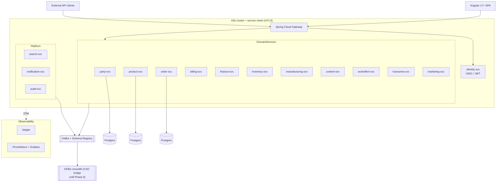

# FUTURESTATE-ARCHITECTURE.md — Apache OFBiz → Microservices (Target State)

> Companion documents: [ARCHITECTURE.md](ARCHITECTURE.md) (current monolith), [LOWLEVEL.md](LOWLEVEL.md) (current implementation reference), [FUTURESTATE-LOWLEVEL.md](FUTURESTATE-LOWLEVEL.md) (target implementation detail).
> Status: **design target** — nothing here is built. Every migration decision still goes through its own spec/plan cycle.

---

## Document Index

- §1 Purpose & Relationship to Current State
- §2 Decision Record
- §3 Target Architecture Overview (+ diagram)
- §4 Service Catalog
- §5 Domain Service Specifications (×11)
- §6 Platform Service Specifications (×5)
- §7 Data Architecture
- §8 Event Taxonomy
- §9 Cross-Cutting Concerns
- §10 Migration Roadmap (Strangler, Phases 0–6)
- §11 Open Questions

---

## 1. Purpose & Relationship to Current State

This document specifies the target architecture for migrating the OFBiz monolith (28 components, 904 entities, 3 engines, single JVM — see ARCHITECTURE.md) to independently deployable microservices with clean architecture per service.

**Deltas from current state:**

| Dimension | Current | Target |
|---|---|---|
| Deployable | 1 monolith (embedded Tomcat) | 16 services on Kubernetes |
| Data | 1 shared DB, entity XML, Delegator API | DB-per-service, JPA, Flyway |
| Logic | Service Engine (XML-declared, 9 engine types) | Spring services, gRPC/REST + Kafka events |
| UI | Widget XML + FreeMarker themes | Headless APIs + Angular 17+ SPA |
| Auth | userLogin + Security interface + JWTManager | Spring Authorization Server (OIDC) |
| Async | JobManager job sandbox + JMS | Kafka event streams + outbox |
| Java | 17 | 21 (virtual threads) |

## 2. Decision Record

Decisions locked 2026-10-16 brainstorming session:

| # | Decision | Choice | Notes |
|---|---|---|---|
| D1 | Service boundaries | DDD bounded contexts | ~11 domain + 5 platform services |
| D2 | Migration strategy | Strangler | Coexist with monolith behind gateway |
| D3 | Domain scope | Full ERP | All 12 OFBiz domains |
| D4 | Data | Database-per-service | Entities split by ownership; JPA/Hibernate |
| D5 | Frontend | Headless + SPA | Angular 17+ (not AngularJS — EOL) |
| D6 | API edge | Spring Cloud Gateway | Routing, JWT validation, rate limits |
| D7 | Async | Kafka event-driven | Streams, outbox, selective event sourcing |
| D8 | Platform | Kubernetes + service mesh | Istio recommended, Linkerd acceptable |
| D9 | Identity | Spring Authorization Server | OIDC/JWT; party data stays in party-svc |
| D10 | Stack | Java 21 + Spring Boot 3.3.x | Clean architecture per service |

**Amendments to global CLAUDE.md for this program:**
1. Kafka replaces RabbitMQ as the event backbone (D7).
2. Kubernetes + mesh replaces Docker Compose as deploy target (D8).
Both amendments scoped to this migration program only.

## 3. Target Architecture Overview



Rules:
- North-south traffic: SPA/clients → gateway → REST only. East-west: gRPC only, inside mesh mTLS.
- Services never read another service's database; cross-context data via API call or event.
- Every state change that other contexts care about is published to Kafka via outbox (atomic with the DB transaction).

## 4. Service Catalog

### Domain services

| # | Service | Bounded context | Owns (entitymodel slice, entity counts from tree) |
|---|---|---|---|
| 1 | `party-svc` | Parties, roles, relationships, contact mechanisms | party (133 entities) |
| 2 | `product-svc` | Catalog, categories, features, prices | product, non-facility (≈192 of 209) |
| 3 | `order-svc` | Order lifecycle, status, returns, quotes | order (114) |
| 4 | `billing-svc` | Invoices, payments, gateway integrations | accounting AR/AP documents (≈90 of 184) |
| 5 | `finance-svc` | GL, accounts, transactions, fiscal periods | accounting ledger (≈94 of 184) |
| 6 | `inventory-svc` | Facilities, stock, shipments | shipment (47) + product-facility slice (≈17) |
| 7 | `manufacturing-svc` | BOM, routing, MRP | manufacturing (9) |
| 8 | `content-svc` | CMS, documents, data resources | content (79) |
| 9 | `workeffort-svc` | Projects, tasks, calendars | workeffort (41) |
| 10 | `humanres-svc` | Employees, positions, employments | humanres (46) |
| 11 | `marketing-svc` | Campaigns, tracking codes, opportunities | marketing (42) |

### Platform services

| Service | Role | Replaces (OFBiz) |
|---|---|---|
| `identity-svc` | OIDC issuer, JWT, permission checks | userLogin entity access, `LoginWorker`, `Security` interface, `JWTManager` |
| `gateway` | Edge routing, authn enforcement, rate limits | `ControlServlet`/`RequestHandler` front-door role |
| `search-svc` | OpenSearch indexing + query API | Solr integration (docker demo applySolrConfig) |
| `notification-svc` | Email/push fan-out on events | common email services |
| `audit-svc` | Event-sourced audit store, secret auditing | `SecretAuditContainer`, ServerHit tracking |

## 5. Domain Service Specifications

Each service: same clean-arch module layout, same contract shape (specified once in §5.0, then per-service specifics).

### 5.0 Common per-service contract

**Module layout (Maven multi-module per service):**
```
party-svc/
  party-domain/        # pure Java: entities, VOs, domain services, use-case ports
  party-application/   # use cases, transaction boundaries, outbox writes
  party-adapters/      # REST (edge) + gRPC (internal) + Kafka producer/consumer adapters
  party-infrastructure/# JPA repos, Postgres config, gateway/other-service clients
```
Dependencies point inward only (adapters/infrastructure → application → domain). Domain has zero Spring imports.

**API surface:** REST (OpenAPI 3, edge, via gateway at `/api/v1/<context>/...`) + gRPC (internal, protobuf, `<context>.v1` package). P99 < 200ms for sync calls; OTel spans on every hop.

**Events:** published via outbox table + relay; topic naming `<context>.<aggregate>.<action>.v1` (§8).

### 5.1 party-svc
- **Purpose:** single source of truth for people/organizations, their roles, relationships, contact data.
- **OFBiz mapping:** `applications/party` services + party entitymodel (133 entities: Party-prefixed 60, attribute/contact groups, ...).
- **API highlights:** `PartyService` gRPC (getParty, upsertParty, findPartiesByRole, linkContactMech); REST `/api/v1/parties`.
- **Publishes:** `party.party.created/updated`, `party.role.granted/revoked`.
- **Consumes:** none (zero inbound dependencies — first migration candidate).
- **Notes:** identity-svc consumes party events to enrich tokens; userLogin credentials migrate to identity-svc, party-svc keeps identity linkage only.

### 5.2 product-svc
- **Purpose:** catalog, categories, product features, prices, product configurations.
- **OFBiz mapping:** `applications/product` (non-facility, non-inventory parts); product entitymodel minus facility/stock entities (≈192).
- **API:** `ProductService` gRPC (getProduct, searchProducts, upsertPrice, category trees); REST `/api/v1/products`, `/api/v1/categories`.
- **Publishes:** `product.product.created/updated`, `product.price.changed`, `product.category.changed`.
- **Consumes:** none.
- **Notes:** replaces `SeoControlServlet` URL concerns via SPA routing; search delegation via events → search-svc.

### 5.3 order-svc
- **Purpose:** order lifecycle — cart → placed → approved → completed; returns; quotes.
- **OFBiz mapping:** `applications/order`; order entitymodel (114: Order-prefixed 46, Return 23, Quote 12...).
- **API:** `OrderService` gRPC (placeOrder, transitionStatus, addItem, getOrder); REST `/api/v1/orders`.
- **Publishes:** `order.order.placed/approved/completed/cancelled`, `order.return.created`.
- **Consumes:** `product.price.changed` (price at order time snapshot), `party.party.updated` (bill-to ship-to validation), `inventory.stock.reserved` (async confirm).
- **Notes:** OFBiz OrderServices → use cases 1:1 where sensible; ECA chains become saga/event flows.

### 5.4 billing-svc
- **Purpose:** invoices, payments, payment gateway integrations, customer/supplier billing documents.
- **OFBiz mapping:** AR/AP slice of `applications/accounting` (≈90 entities: Invoice*, Payment*, BillingAccount*...).
- **API:** `BillingService` gRPC (createInvoice, recordPayment, captureAuthorization); REST `/api/v1/invoices`, `/api/v1/payments`; **payment-gateway adapters** live here (replaces PaymentGatewayServices).
- **Publishes:** `billing.invoice.issued/settled`, `billing.payment.captured/failed`.
- **Consumes:** `order.order.completed` (invoice generation), `finance.transaction.posted` (GL confirmation handshake).
- **Notes:** PCI scope confined to this service's gateway adapters.

### 5.5 finance-svc
- **Purpose:** general ledger, chart of accounts, journal transactions, fiscal periods, currency.
- **OFBiz mapping:** ledger slice of accounting (≈94 entities: GlAccount*, GlJournal*, AcctgTrans*, FinAccount*...).
- **API:** `FinanceService` gRPC (postTransaction, closePeriod, trialBalance); REST `/api/v1/gl`.
- **Publishes:** `finance.transaction.posted`, `finance.period.closed`.
- **Consumes:** `billing.invoice.issued/settled` → auto GL posting rules (replaces accounting ECAs).
- **Notes:** accounting entitymodel split billing/finance is the hardest migration cut; exact entity assignment enumerated in FUTURESTATE-LOWLEVEL.md §2.

### 5.6 inventory-svc
- **Purpose:** facilities, warehouses, stock levels, shipments, reservations.
- **OFBiz mapping:** shipment entitymodel (47) + product entitymodel facility slice (Facility*, InventoryItem* ≈17).
- **API:** `InventoryService` gRPC (reserveStock, releaseReservation, adjustStock, shipOrder); REST `/api/v1/facilities`, `/api/v1/shipments`.
- **Publishes:** `inventory.stock.reserved/adjusted/shipped`.
- **Consumes:** `order.order.placed` (reserve), `order.order.cancelled` (release), `product.product.updated`.
- **Notes:** replaces oversell-prevention style semaphores with reservation saga + optimistic concurrency.

### 5.7 manufacturing-svc
- **Purpose:** BOM, production routing, MRP runs.
- **OFBiz mapping:** manufacturing entitymodel (9 entities) + MrpServices/ProposedOrder logic.
- **API:** `ManufacturingService` gRPC (runMrp, getBom, planProduction).
- **Publishes:** `manufacturing.mrp.run.completed`, `manufacturing.productionorder.created`.
- **Consumes:** `inventory.stock.adjusted`, `order.order.placed` (demand input), `product.product.updated` (BOM inputs).
- **Notes:** MRP becomes a Kafka Streams job over demand/supply topics (replaces JobManager-scheduled MrpServices).

### 5.8 content-svc
- **Purpose:** CMS, documents, data resources, content trees.
- **OFBiz mapping:** `applications/content`; content entitymodel (79).
- **API:** `ContentService` gRPC + REST `/api/v1/content`.
- **Publishes:** `content.content.published/updated`.
- **Consumes:** none (product images referenced by product-svc via URL).
- **Notes:** replaces WebDAV servlet surface with S3-compatible object storage adapter.

### 5.9 workeffort-svc
- **Purpose:** projects, tasks, timesheets, calendars.
- **OFBiz mapping:** workeffort entitymodel (41: WorkEffort-prefixed 34).
- **API:** `WorkEffortService` gRPC + REST `/api/v1/workefforts`.
- **Publishes:** `workeffort.effort.created/completed`.
- **Consumes:** none.
- **Notes:** iCalendar/WebDAV endpoints (ICalHandler) become REST calendar export adapter.

### 5.10 humanres-svc
- **Purpose:** employees, positions, employments, skills, payroll inputs.
- **OFBiz mapping:** humanres entitymodel (46).
- **API:** `HumanResourcesService` gRPC + REST `/api/v1/hr`.
- **Publishes:** `hr.employment.started/ended`.
- **Consumes:** `party.party.created` (employee is a party role).
- **Notes:** party linkage by ID only — no party data duplication.

### 5.11 marketing-svc
- **Purpose:** campaigns, tracking codes, opportunities, contact lists.
- **OFBiz mapping:** marketing entitymodel (42: SalesForecast/TrackingCode groups).
- **API:** `MarketingService` gRPC + REST `/api/v1/marketing`.
- **Publishes:** `marketing.campaign.launched`, `marketing.opportunity.won`.
- **Consumes:** `order.order.placed` (attribution via tracking codes), party events (segment refresh).

## 6. Platform Service Specifications

### 6.1 identity-svc
- Spring Authorization Server: OIDC issuer, client-credentials + authorization-code + PKCE flows.
- Issues JWTs with party/permission claims sourced from party-svc events (local projection).
- Permission model replaces OFBiz Security interface: role → permission groups, evaluated at gateway + in-service (method security).
- User store: own schema (credentials), party linkage by `partyId` reference.

### 6.2 gateway
- Spring Cloud Gateway: route table `/api/v1/<context>/** → <context>-svc`; JWT validation filter (JWKS from identity-svc); rate limiting (Redis token bucket); OTel context propagation.
- During strangler: default route → OFBiz monolith (TLS termination at ingress), migrated contexts progressively carved out (§10).

### 6.3 search-svc
- OpenSearch cluster; consumes product/content/party change events → index projections; query API via gRPC + REST `/api/v1/search`.

### 6.4 notification-svc
- Template store + email/push adapters; consumes `notification.requested` commands from any service; retry with DLQ; replaces OFBiz email services.

### 6.5 audit-svc
- Consumes ALL domain topics (wildcard subscription) into an append-only event store (Postgres partitioned by month) + secret-audit events (replaces SecretAuditContainer). Query API for compliance.

## 7. Data Architecture

- **DB-per-service:** dedicated Postgres 16 database + schema per service; credentials per service (K8s secrets / Vault).
- **Entity ownership:** the 904 entities assign by entitymodel file per §4 table; the two splits (product→inventory facility slice; accounting→billing/finance) enumerated entity-by-entity in FUTURESTATE-LOWLEVEL.md §2.
- **Persistence:** Spring Data JPA + Hibernate 6; Flyway migrations; no entity XML, no shared persistence module.
- **Outbox pattern:** every service DB has `outbox` table; relay publishes to Kafka; consumers idempotent by `event_id`.
- **No cross-DB joins.** Composability at gateway (BFF-style) or SPA.
- **Interop during strangler:** Debezium CDC on monolith Postgres → Kafka `ofbiz.<entity>.<action>` topics → migrating service's projection tables; reverse sync for write cutover phases via anti-corruption layer in each new adapter.

## 8. Event Taxonomy

- Topics: `<context>.<aggregate>.<action>.v<N>` — e.g. `order.order.placed.v1`.
- Keys: aggregate ID (`orderId`) → per-aggregate ordering.
- Formats: Avro + Schema Registry (compat: BACKWARD); protobuf acceptable if gRPC schema reuse wins.
- Commands (request/response async): `<context>.<thing>.requested` with reply topic + correlation ID.
- DLQ: `<topic>.dlq`; consumer retries exponential, then DLQ + alert.
- Retention: domain topics 7 days; audit topics infinite (compact + archive).

## 9. Cross-Cutting Concerns

- **Security:** mesh mTLS east-west; JWT at gateway + services; authorization = role claims + method security; PCI scope isolated in billing-svc.
- **Observability:** OTel SDK every service → Jaeger traces, Prometheus metrics (`/actuator/prometheus`), Grafana dashboards; structured JSON logs → Loki (optional).
- **Testing:** domain unit tests; application slices with Testcontainers (Postgres+Kafka); consumer-driven contract tests (gRPC/REST + Avro) published as artifacts; E2E per release on staging K8s.
- **Resilience:** mesh retries/timeouts/circuit-breaking; idempotent consumers; saga compensation for cross-service flows.
- **Build:** Maven or Gradle multi-repo (`<context>-svc` repo each) OR mono-repo with directory-per-service — decided per team topology at Phase 0 (open question §11).

## 10. Migration Roadmap (Strangler)

| Phase | Delivers | Exit criteria (cutover gate) |
|---|---|---|
| 0 Platform | K8s+mesh, Kafka+registry, gateway (routing to monolith), identity-svc, OTel stack | Monolith reachable through gateway; OIDC login proxies to monolith session |
| 1 Party | party-svc, audit-svc, CDC party topics | 100% party reads via API; monolith party tables fed by reverse-sync or frozen |
| 2 Product+Inventory | product-svc, inventory-svc, search-svc | Catalog browse + stock via new APIs; SPA catalog screens live |
| 3 Order | order-svc | Order placement e2e through new stack; monolith order writes disabled |
| 4 Billing+Finance | billing-svc, finance-svc, notification-svc | Invoice/payment e2e; GL postings balanced vs monolith trial balance |
| 5 Long tail | manufacturing, workeffort, humanres, content, marketing (parallel) | All 12 domains served by target stack |
| 6 Decommission | Remove CDC bridges; retire monolith | Monolith scaled to zero for 30 days, then archived |

Rollback per phase: gateway route flip back to monolith (CDC reverse-sync keeps data consistent during rollback window).

## 11. Open Questions

1. Repo layout: mono-repo vs repo-per-service (decide Phase 0).
2. Exact billing/finance entity split review — accounting SME sign-off required (FUTURESTATE-LOWLEVEL.md §2 draft).
3. Do any downstream consumers need the OFBiz SOAP surface preserved during strangler?
4. Angular SPA hosting/deployment (separate repo + CDN vs served by gateway).
5. Multi-tenancy: OFBiz delegator tenant support — required in target? (affects identity-svc + row-level isolation).

---

*Designed 2026-10-16 brainstorming session; entity counts derived from working tree (`applications/datamodel/entitydef/`). Implementation detail: FUTURESTATE-LOWLEVEL.md.*
