# C4 Diagrams — Monolith, Distributed Target, and Key Flows

> Sources of truth: [ARCHITECTURE.md](../../ARCHITECTURE.md) (current),
> [FUTURESTATE-ARCHITECTURE.md](../../FUTURESTATE-ARCHITECTURE.md) (target).
> Rendered by GitHub/mermaid-capable viewers. Component-level detail for the
> remaining 10 domain services follows the order-svc exemplar pattern
> (§5); per-service expansion happens in each service's spec.

---

## 1. Monolith — System Context (C4 L1)

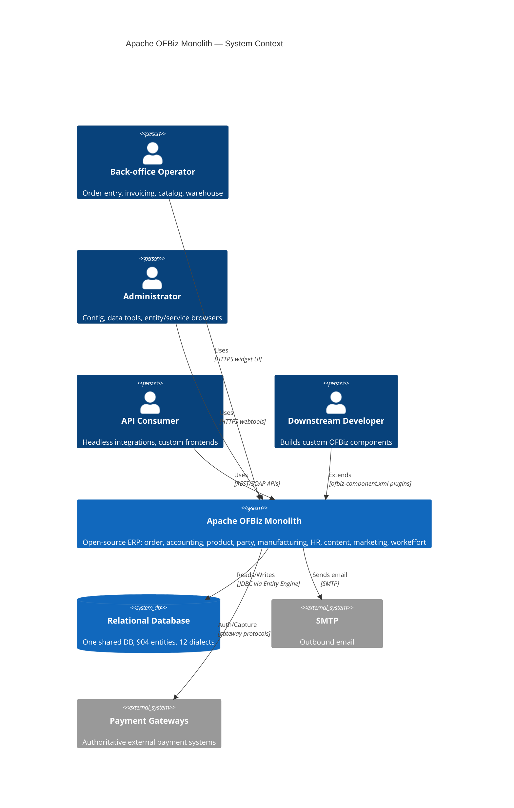

## 2. Monolith — Containers (C4 L2)

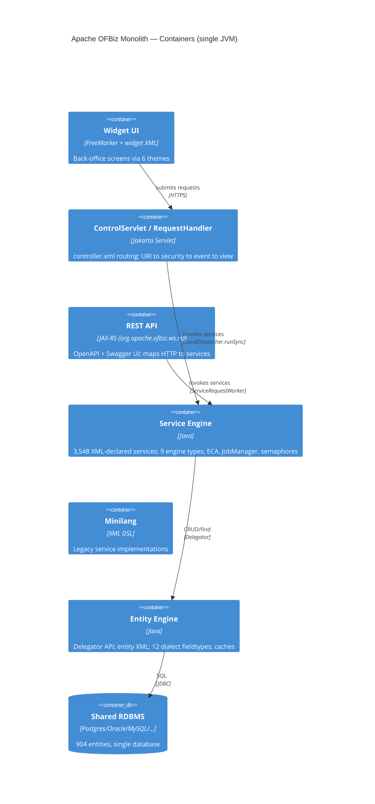

## 3. Distributed Target — System Context (C4 L1)

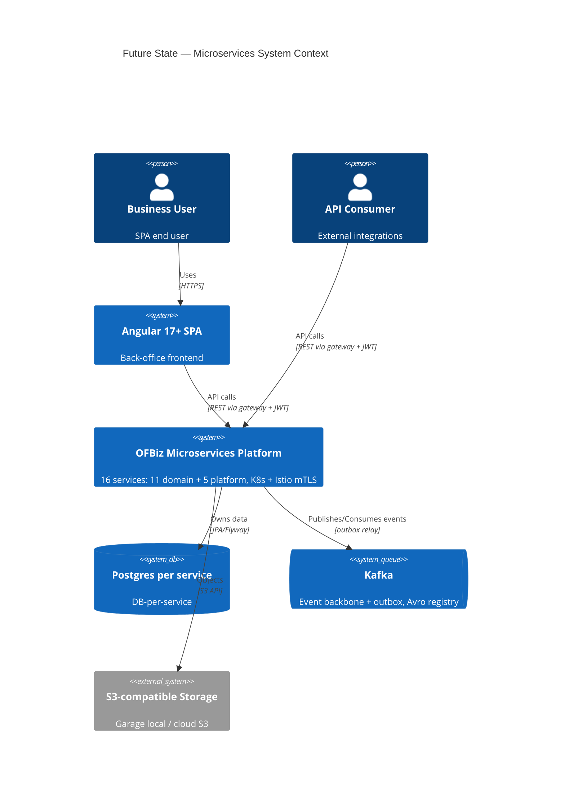

## 4. Distributed Target — Containers (C4 L2)

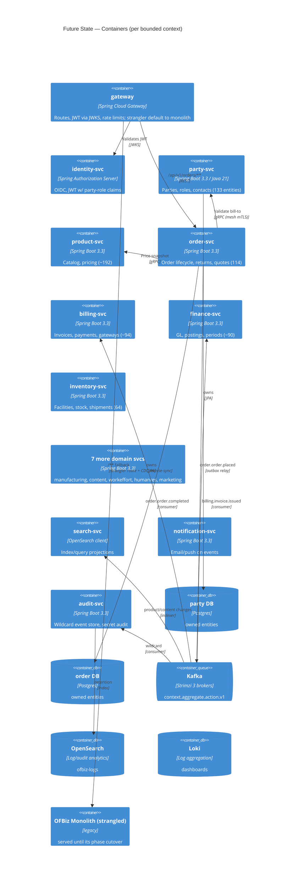

## 5. Component View — order-svc exemplar (C4 L3)

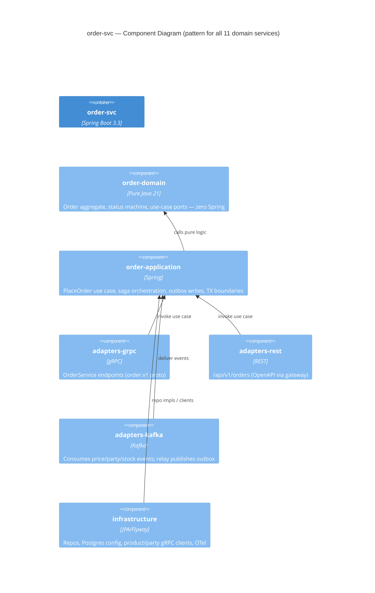

## 6. Sequence — OIDC Login & API Call

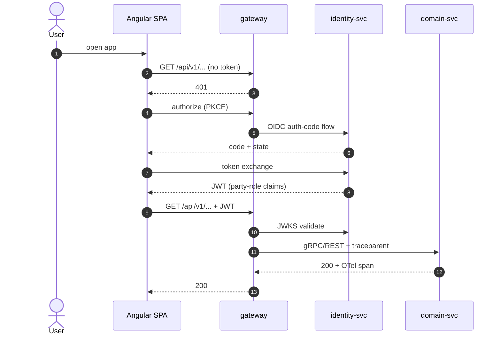

## 7. Sequence — Place Order Saga (outbox + events)

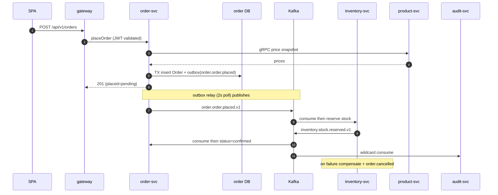

## 8. Sequence — Outbox Publish (atomicity)

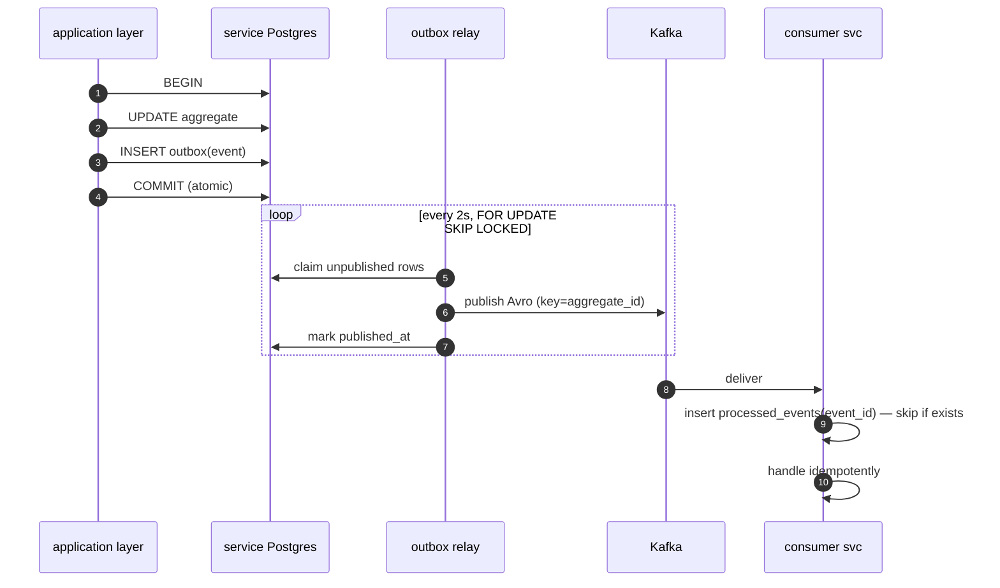

## 9. Sequence — Strangler CDC Bridge (write cutover)

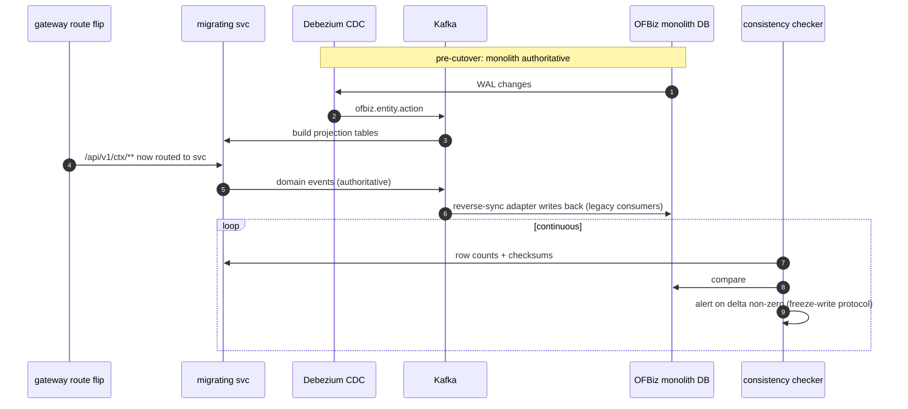

## 10. Sequence — Content Upload to S3 (Garage local / cloud s3)

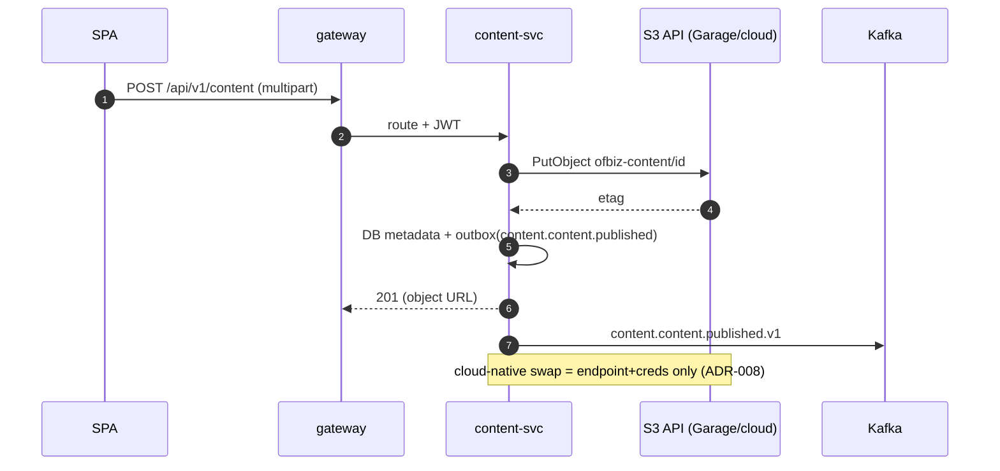

## 11. Deployment View — Local Platform (as-built, Phase 0)

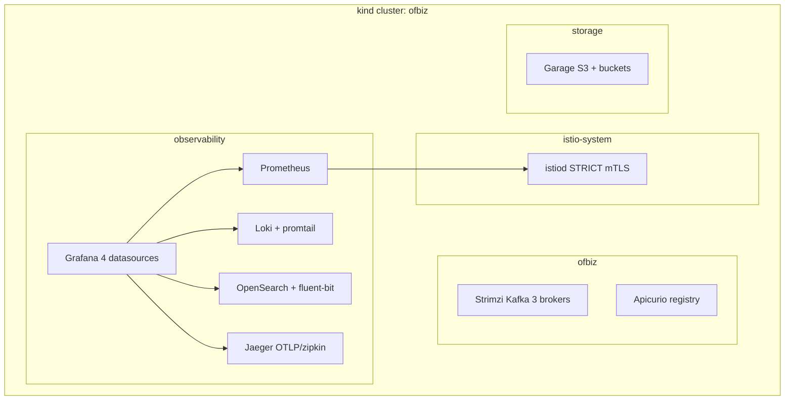

---

*Maintained alongside the architecture docs; topology changes update §3-4 in the same PR (CLAUDE.md process rules).*
